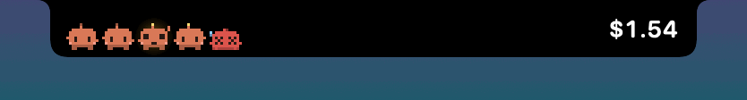

# Peek

Your Claude Code agents, living in the MacBook notch.

Each session shows up as a small pixel character. Hover the notch to see what every agent is doing, how full its context window is and what it has cost. When an agent asks for permission, approve or deny it right there.

**[peek-beta.vercel.app](https://peek-beta.vercel.app)**: try the live demo in your browser.

<p align="center">
  
</p>

## Install

Requires macOS 14+, Xcode 16+ and [Claude Code](https://code.claude.com).

```sh
git clone https://github.com/Evanlei/Peek.git
cd Peek
make run            # build and launch
make install-hook   # optional: approve permission requests from the notch (needs jq)
```

To keep Peek running, move `build/Build/Products/Release/Peek.app` to `/Applications` and add it to **System Settings → General → Login Items**. To quit, right-click the open notch and choose **Quit Peek**.

On Macs without a notch, Peek shows as a small pill under the menu bar.

## What you see

<p align="center"></p>

**Collapsed:** one small character per active session next to the notch, and the total cost on the right.

**Expanded (on hover):** each session gets a desk in a small room.

| Character | Meaning |
|---|---|
| Types at its desk | **Working**: running a tool or thinking |
| Waves under an amber **!** | **Needs you**: a permission request is waiting |
| Slumps under a rain cloud | **Stuck**: a tool has run over 5 minutes, or 3 calls failed in a row |
| Dozes with a *z* | **Idle**: waiting for your next prompt |
| Small character following a bigger one | A **subagent** |

The bar above each name shows context-window usage, and characters look tired above 80%. Each label is the repo name, with the branch added when several sessions share a repo.

**Approvals:** when a request comes in, the notch opens on its own. Click **Allow** or **Deny** and Claude Code continues. If you answer in the terminal instead, the card goes away.

<p align="center"></p>

## How it works

**Sessions.** Peek reads the logs Claude Code already writes to `~/.claude/projects/`. Every 2 seconds it reads only the new lines in recently changed files. From them it takes the project, branch, context usage, cost, current tool call and subagents.

**Approvals.** `make install-hook` adds one `PermissionRequest` hook to `~/.claude/settings.json`, after making a backup. When Claude Code is about to ask for permission:

1. The hook sends the request to Peek on `127.0.0.1:47823`.
2. Peek shows the card.
3. Your choice goes back to Claude Code as the hook's decision.

If Peek isn't running, or you ignore a request for about 9½ minutes, Claude Code falls back to its normal terminal prompt. `make uninstall-hook` removes only Peek's entry. The hook applies to sessions started after you install it.

**Privacy.**
- Nothing leaves your Mac, and Peek makes no network requests.
- The approval server listens only on `127.0.0.1`.
- Every approval request must include a token from `~/.peek/token` (mode `0600`).
- Peek runs without the App Sandbox because it needs to read `~/.claude`.

**Performance.** Peek draws with SpriteKit and reuses cached sprites. In a Release build on Apple silicon it uses about 2–3% CPU while collapsed and about 8% while expanded.

## Development

```
Peek/
  PeekApp.swift          App entry; live or demo data
  NotchController.swift  Panel, hover detection, open/alert/collapse
  NotchGeometry.swift    Notch measurement and sizes
  NotchView.swift        Collapsed strip, diorama, footer
  ApprovalCard.swift     Approval card and transitions
  SceneCanvas.swift      Scene layout; SpriteKit host
  SceneSim.swift         Character movement
  Critter.swift          The pixel character
  SpriteCache.swift      Draw-once image cache
  SessionScanner.swift   Log reader, pricing, context windows
  HookServer.swift       Loopback HTTP server
  HookBridge.swift       PermissionRequest protocol and hook script
  AgentStore.swift       Live state and demo simulation
scripts/                 Hook install and uninstall
site/                    Landing page (Next.js); `make site` to run it
```

| Command | What it does |
|---|---|
| `make run` | Release build and launch |
| `make debug` | Debug build, with the snapshot and `/debug` extras |
| `make demo` | Launch with fake agents that cycle through every state |
| `make dist` | Universal `build/dist/Peek.zip` |
| `make stop` | Quit Peek |

Environment variables:

| Variable | Effect |
|---|---|
| `PEEK_FAKE=1` | Demo agents instead of real sessions |
| `PEEK_EXPANDED=1` / `0` | Pin the notch open or closed |
| `PEEK_STYLE=diorama\|stage\|lanes` | Use another layout (also in the right-click menu) |
| `PEEK_FORCE_PILL=1` | Show the no-notch pill on a notched Mac |
| `PEEK_SNAPSHOT=/path.png` | Debug builds only: save a screenshot of Peek's window (`PEEK_SNAPSHOT_DELAY=s` to wait) |

Debug builds also accept `POST /debug/decide` with body `allow` or `deny`, which answers the oldest waiting request.

## Known limits

- Cost can differ slightly from Claude Code's own total between the times Claude Code records it.
- The 5-hour usage ring appears only in demo mode, because plan limits aren't in the logs.
- It's not yet confirmed whether Claude Code shows its terminal prompt while the hook waits. If the prompt only appears after you answer in the notch, lower `holdSeconds` in `HookBridge.swift`.

## Roadmap

- Click a character to jump to its terminal.
- "Always allow" using Claude Code's permission suggestions.
- A small settings panel: scan window, which tools go to Peek, launch at login.
