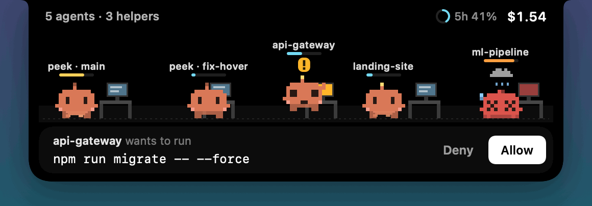
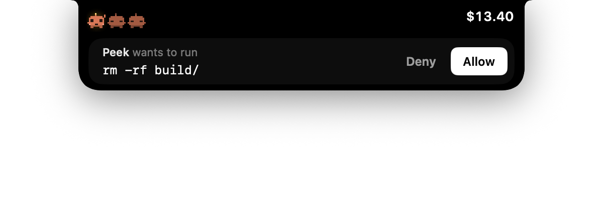

# Peek

Peek is a macOS app that lives in your MacBook's notch and shows your Claude Code agents as small pixel characters. Hover the notch to see what each agent is doing, how full its context window is, and what it has cost. When an agent asks for permission, you can approve or deny it from the notch.

<p align="center">
  
</p>

## What you see

**Collapsed.** A row of small characters sits next to the notch, one per active session, with the total cost on the right. They stay nearly still so they don't distract you. Only an agent that needs you hops and glows.

<p align="center"></p>

**Expanded (on hover).** Each session gets a desk in a small room.

| Character | Meaning |
|---|---|
| Types at its desk, then wanders | **Working**: a tool is running or Claude is thinking |
| Waves under an amber **!** | **Needs you**: a permission request is waiting |
| Slumps, red, under a rain cloud | **Stuck**: one tool call has run for more than 5 minutes, or 3 tool calls failed in a row |
| Dozes with a floating *z* | **Idle**: the turn ended and it's waiting for your next prompt |
| Small character following a bigger one | A **subagent** working for that session |

- The bar above each name shows **context-window usage**. Characters get tired above 80%.
- Each label is the repo name. When several sessions share a repo, the label adds the branch, for example `cues · fix-login`.
- When nothing needs you, the footer shows what the busiest agent is doing right now.

**Approvals.** When a session asks for permission, the notch opens on its own to show the request:

<p align="center"></p>

Click **Allow** or **Deny** and Claude Code continues. If you answer in the terminal instead, the card goes away.

## Requirements

- macOS 14 or later. On Macs without a notch, Peek shows as a floating pill under the menu bar.
- Xcode 16 or later to build it.
- [Claude Code](https://code.claude.com). Approvals need a version with the `PermissionRequest` hook.
- `jq`, used by the hook install script (`brew install jq`).

## Install

```sh
git clone https://github.com/Evanlei/Peek.git
cd Peek
make run            # build a Release app and launch it
make install-hook   # optional: approve permission requests from the notch
```

`make run` builds `build/Build/Products/Release/Peek.app`. To keep Peek around, drag the app into `/Applications` and add it under **System Settings → General → Login Items**.

Peek has no Dock icon. To quit, right-click the open notch and choose **Quit Peek**, or run `make stop`.

Run `make demo` to launch it with fake agents that cycle through every state.

## How it works

### Sessions

Peek reads the logs Claude Code already writes to `~/.claude/projects/`. Every 2 seconds it checks for files changed in the last 30 minutes and reads only the lines added since its last check.

| Shown | Source |
|---|---|
| Name | The session's working directory, with worktrees mapped back to the repo name |
| Branch | `gitBranch` from the log |
| Context | The token usage on the latest response, compared with the model's context window |
| Cost | Claude Code's own cost total, plus an estimate for messages since that total was last written |
| Current action | The tool call in progress, for example `Bash: run tests` or `Edit: Router.swift` |
| Subagents | Files under `<session>/subagents/` that changed recently |

The logs don't record a permission prompt that is still waiting. Approvals therefore come from a hook, not from the logs.

### Approvals

`make install-hook` adds one `PermissionRequest` hook to `~/.claude/settings.json`:

```json
{ "matcher": "*", "hooks": [{ "type": "command", "command": "/Users/you/.peek/permission-hook.sh", "timeout": 600 }] }
```

The install script keeps your existing hooks and makes a backup first. `make uninstall-hook` removes only Peek's entry.

When Claude Code is about to ask for permission:

1. The hook script sends the request to Peek on `127.0.0.1:47823` with a secret token stored in `~/.peek/token`.
2. Peek shows the approval card and waits for your decision.
3. Your **Allow** or **Deny** goes back to Claude Code as the hook's decision.

**If Peek isn't running**, the script prints nothing, so Claude Code shows its normal terminal prompt. You'll never get stuck waiting on a closed app. If you ignore a request for about 9½ minutes, Peek hands it back to the terminal.

> The hook only applies to sessions started after you install it. Open `/hooks` in Claude Code to review or disable it.

## Privacy and security

- **Nothing leaves your Mac.** Peek reads local log files and doesn't connect to the internet.
- **Only your own Mac can send approvals.** The approval server listens on `127.0.0.1` only. Requests must include the token in `~/.peek/token` (file permissions `0600`), and requests without it get `403`.
- **App Sandbox is off.** Peek needs to read `~/.claude`, so it doesn't run in the macOS App Sandbox.

## Performance

Peek runs all the time, so it's built to stay light:

- The scene renders with SpriteKit.
- Each sprite, label and prop is drawn once, cached, and reused on later frames.
- The collapsed strip updates 4 times a second, or 12 times while an agent is hopping for attention.

On an Apple-silicon MacBook with a Release build, it uses about **2–3% CPU collapsed** and about **8% while expanded**. It only expands while you hover or a request is waiting.

## Landing page

`site/` is the landing page: Next.js 15, Tailwind 4 and Motion. It includes a live, in-browser recreation of the notch. Run it with `make site`.

## Development

```
Peek/
  PeekApp.swift          App entry; picks live or demo data
  NotchController.swift  Panel, hover detection, open/alert/collapse states
  NotchGeometry.swift    Notch measurement and sizes for each state
  NotchView.swift        Collapsed strip, Diorama, footer, approval card
  ApprovalCard.swift     The approval card, buttons, transitions
  SceneCanvas.swift      Scene layout and drawing; SpriteKit host
  SceneSim.swift         Character movement: wandering, desks, hops, sidekicks
  Critter.swift          The pixel character and its overlays (bubble, cloud, z)
  SpriteCache.swift      Draw once, reuse image cache
  SessionScanner.swift   ~/.claude/projects log reader, pricing, context windows
  HookServer.swift       Loopback HTTP server
  HookBridge.swift       PermissionRequest protocol, token, hook script
  AgentStore.swift       Live state + demo simulation
scripts/                 install-hook.sh / uninstall-hook.sh
.plans/                  Design spec and earlier layout previews
```

Environment variables (the snapshot ones work in Debug builds only, from `make debug`):

| Variable | Effect |
|---|---|
| `PEEK_FAKE=1` | Demo agents instead of real sessions |
| `PEEK_EXPANDED=1` / `0` | Pin the notch open or closed |
| `PEEK_STYLE=diorama\|stage\|lanes` | Use another layout. Right-click the open notch to switch. |
| `PEEK_FORCE_PILL=1` | Show the no-notch pill on a notched Mac |
| `PEEK_SNAPSHOT=/path.png` (+ `PEEK_SNAPSHOT_DELAY=s`) | Debug only. Save a screenshot of Peek's own window. No Screen Recording permission needed. |

Debug builds also accept `POST /debug/decide` with body `allow` or `deny`. It answers the oldest waiting request, which is useful for testing approvals without clicking.

## Known limits

- **Cost** is close to Claude Code's own total but can drift slightly between the times Claude Code records it.
- **The 5-hour usage ring** appears only in demo mode. Plan limits aren't in the logs.
- **Terminal prompt timing:** the hook docs don't say whether Claude Code shows its terminal prompt while a hook is waiting. If you only see the prompt after answering in the notch, lower `holdSeconds` in `HookBridge.swift`.

## Roadmap

- Click a character to jump to its terminal.
- "Always allow" using Claude Code's permission suggestions.
- A small settings panel: scan window, which tools to route to Peek, launch at login.
